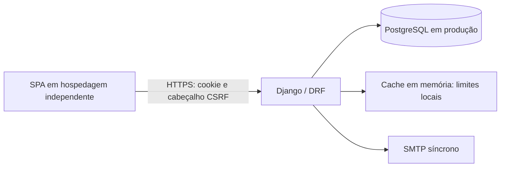

# Template Django REST para SPAs

Backend pequeno para cadastro, login, recuperação de senha e manutenção da própria conta. O frontend pode estar em outro provedor; a API mantém a autenticação em cookies que o JavaScript não consegue ler.

**Público-alvo:** pessoas iniciantes em backend, com conhecimentos básicos de Python e HTTP.

> Esta revisão foi verificada apenas estaticamente. O mantenedor ainda precisa atualizar `pdm.lock`; os testes existentes continuam no contrato antigo de JWT e não foram alterados nem executados. Não considere a implantação validada.

## Sumário

- [Começar localmente](#começar-localmente)
- [Entender a arquitetura](#entender-a-arquitetura)
- [Integrar uma SPA](#integrar-uma-spa)
- [Endpoints](#endpoints)
- [Publicar](#publicar)
- [Manutenção e limites](#manutenção-e-limites)
- [Transição da versão anterior](#transição-da-versão-anterior)

## Começar localmente

Requisitos: Python 3.14 e PDM. Não precisa de Redis, fila ou Docker.

Como o lock ainda corresponde à versão anterior, o mantenedor deve primeiro executar `pdm lock` e revisar o resultado. Depois:

```bash
pdm sync -G dev
pdm run migrate
pdm run dev
```

- API: `http://localhost:8000/`.
- Documentação interativa: `http://localhost:8000/api/docs/urls/`.
- Admin: `http://localhost:8000/admin/`. Crie uma conta com `pdm run python manage.py createsuperuser`.
- SQLite: arquivo `db.sqlite3`; parar a aplicação não o apaga.
- E-mails: aparecem no terminal, inclusive os códigos de desenvolvimento. Use somente contas de teste.
- Frontend local: `http://localhost:5173` ou `http://localhost:3000`. Não misture `localhost` com `127.0.0.1` no navegador.

O desenvolvimento usa uma chave pública e cookies para HTTP local. **Nunca publique esse perfil.** A aplicação não carrega arquivos de ambiente automaticamente.

Docker local é opcional: `pdm run dev:up`; acompanhe com `dev:logs` e pare com `dev:down`. O código e o SQLite são compartilhados com a pasta do projeto; não execute migrações concorrentes nesse arquivo. Ajuste `LOCAL_UID`/`LOCAL_GID` no ambiente do terminal se necessário.

## Entender a arquitetura



| Local | Responsabilidade |
| --- | --- |
| `app/urls.py` | Entrada das rotas |
| `app/settings/` | Base compartilhada, desenvolvimento e produção |
| `core/models/` | Usuário e códigos de confirmação |
| `core/<funcionalidade>/views.py` | Receber HTTP e devolver respostas |
| `core/<funcionalidade>/serializers.py` | Validar os dados de entrada e descrever a saída |
| `core/<funcionalidade>/services.py` | Executar regras de negócio e transações |
| `core/shared/` | E-mail, documentação, IP e logs de segurança |

Para adicionar uma funcionalidade, siga essa divisão e registre suas rotas. Não é necessário criar uma nova aplicação Django para cada operação. A [referência técnica](docs/ARCHITECTURE.md) resume os pontos de integração para desenvolvedores e agentes de IA.

**Sessão:** o navegador guarda um identificador opaco; o estado fica na tabela de sessões do Django. A validade é fixa em 24 horas a partir do login, inclusive no admin. Não há refresh token nem renovação por atividade. Ao expirar, é necessário entrar novamente.

Trocar a senha por recuperação, confirmar outro e-mail ou desativar a conta invalida todos os acessos. Isso impede requisições seguintes; não desfaz uma operação já autorizada e em andamento. Alterações sensíveis bloqueiam e conferem novamente o usuário no banco. SQLite não reproduz esses bloqueios do PostgreSQL.

## Integrar uma SPA

### Primeiro, a restrição do navegador

**HttpOnly protege a leitura da credencial, mas não obriga o navegador a aceitar o cookie.** Entre sites distintos, o funcionamento depende da política de cookies de terceiros. `SameSite=None; Secure` e CORS são necessários, mas não garantem compatibilidade universal. Valide os navegadores-alvo antes de escolher os domínios de produção.

Provedores diferentes também podem usar subdomínios do mesmo domínio próprio, evitando essa dependência de cookies entre sites. Não há fallback para tokens em `localStorage`.

### Fluxo com fetch

O backend guarda a credencial em cookie HttpOnly. A SPA mantém **somente o token CSRF em memória**: ele protege operações, não autentica a pessoa sozinho.

```javascript
const API = "https://api.exemplo.net";

const bootstrap = await fetch(`${API}/api/login/`, {
  credentials: "include",
  cache: "no-store",
});
if (!bootstrap.ok) throw new Error("Não foi possível preparar o CSRF");
let { csrfToken } = await bootstrap.json();

const login = await fetch(`${API}/api/login/`, {
  method: "POST",
  credentials: "include",
  headers: { "Content-Type": "application/json", "X-CSRFTOKEN": csrfToken },
  body: JSON.stringify({ email, password }), // valores do formulário
});
const result = await login.json();
if (!login.ok) throw new Error(result.detail || "Não foi possível entrar");
csrfToken = result.csrfToken; // o login rotaciona o CSRF

const profile = await fetch(`${API}/api/users/me/`, { credentials: "include" });
if (!profile.ok) throw new Error("Sessão indisponível; entre novamente");
const user = await profile.json();
```

Para cadastro ou recuperação, faça o bootstrap antes do primeiro POST, mesmo sem estar autenticado. Todo POST exige `X-CSRFTOKEN` e credenciais incluídas. Para sair, envie POST a `/api/me/logout/` com o token CSRF atual.

No Axios, use `withCredentials: true` e envie explicitamente o mesmo cabeçalho. Não dependa de ele ler o cookie CSRF: o cookie pertence à API e também é HttpOnly. Após recarregar a página ou outro login rotacionar o CSRF, obtenha-o novamente pelo GET. Não repita mutações automaticamente após erros.

- `401`: autenticação ausente, expirada ou revogada.
- `403`: falha de CSRF ou falta de permissão; não significa necessariamente senha incorreta.
- `429`: limite de tentativas; respeite `Retry-After`.
- `503`: operação temporariamente indisponível, como uma falha de envio de código.

HttpOnly não elimina XSS: um script malicioso na SPA ainda pode agir como a pessoa. Evite HTML não confiável e mantenha as dependências do frontend atualizadas. CORS não substitui autenticação nem CSRF.

## Endpoints

| Método e caminho | Uso |
| --- | --- |
| `GET /api/login/` | Obter `csrfToken` sem expor a sessão |
| `POST /api/login/` | Entrar; retorna o CSRF rotacionado |
| `POST /api/me/logout/` | Encerrar o acesso atual |
| `GET /api/users/me/` | Consultar o próprio perfil |
| `POST /api/me/deactivate/` | Desativar a conta com a senha atual |
| `POST /api/registration/request/` e `confirm/` | Solicitar código; confirmar com código, nome e senha |
| `POST /api/password-reset/request/` e `confirm/` | Solicitar código; confirmar com código e nova senha |
| `POST /api/email-change/request/` e `confirm/` | Solicitar e confirmar troca, sempre com a senha atual |
| `GET /api/users/list/` | Lista paginada, exclusiva da equipe (`is_staff`) |

Os detalhes dos campos estão no OpenAPI. Os códigos têm seis dígitos, duram 15 minutos e são inutilizados após cinco erros. O banco guarda apenas o hash. Uma nova emissão substitui o código anterior. Confirmar cadastro não realiza login.

## Publicar

Use `app.settings.prod`, PostgreSQL privado e HTTPS. Injete a configuração pelo painel de segredos/variáveis da hospedagem; não grave credenciais no repositório nem na imagem.

| Variável | Configuração |
| --- | --- |
| `SECRET_KEY` | Chave exclusiva e aleatória, com pelo menos 50 caracteres |
| `ALLOWED_HOSTS` | Hosts da API separados por vírgula, sem protocolo ou `*` |
| `FRONTEND_ORIGINS` | Origens HTTPS explícitas das SPAs, sem barra final; alimenta CORS e CSRF |
| `DATABASE_URL` | URL PostgreSQL do usuário da aplicação, sem privilégios de administrador |
| `EMAIL_HOST`, `DEFAULT_FROM_EMAIL` | Servidor SMTP e remetente autorizado |
| `EMAIL_HOST_USER`, `EMAIL_HOST_PASSWORD` | Credenciais SMTP fornecidas pelo provedor, quando exigidas |
| `EMAIL_PORT`, `EMAIL_USE_TLS`, `EMAIL_USE_SSL` | Padrão: 587 com STARTTLS; não ative TLS e SSL juntos |
| `TRUST_PROXY_HEADERS`, `NUM_PROXIES` | Ative confiança somente no proxy controlado; informe quantos proxies acrescentam IPs |

O perfil emite cookies com prefixo `__Host-`, HttpOnly, Secure, `SameSite=None`, caminho `/` e sem `Domain`. Nunca permita acesso público que contorne um proxy cujos cabeçalhos são considerados confiáveis. Para banco gerenciado, configure TLS e a validação de certificado conforme o provedor.

**PaaS:** inicie Gunicorn com `app.wsgi:application`; configure serviço de arquivos estáticos e HTTPS na plataforma. Execute migrações e `collectstatic` uma única vez no processo de release, antes de liberar as réplicas. A imagem não executa migrações ao iniciar cada processo web.

**VPS com Compose:** a stack incluída contém PostgreSQL, release, aplicação e Nginx. Injete também `POSTGRES_PASSWORD`, `APP_DB_PASSWORD` e uma `DATABASE_URL` coerente com o usuário da aplicação (`template_auth` por padrão). Inclua `localhost` em `ALLOWED_HOSTS` para a verificação interna. Prepare externamente certificados válidos e sua renovação; `TLS_DIR` aponta ao diretório com `fullchain.pem` e `privkey.pem`. Somente o Nginx publica portas. Depois, use `pdm run prod:up` e `pdm run prod:logs`. Não inicie essa stack completa para consumir um PostgreSQL gerenciado sem adaptar a orquestração.

Nenhuma dessas implantações foi construída ou executada nesta refatoração. A verificação HTTP dos contêineres não comprova banco disponível nem entrega de e-mail. Faça backup e valide restauração antes de atender contas reais. Volumes não substituem backups; não use `down -v` com dados que precise preservar.

## Manutenção e limites

- Agende `python manage.py cleanup_auth --settings=app.settings.prod` na hospedagem, por exemplo diariamente. O comando remove cadastros incompletos elegíveis após 48 horas, códigos vencidos e sessões expiradas. Contas com senha definida ou privilégios administrativos não são removidas como cadastros abandonados.
- SMTP ocorre na própria requisição, depois da confirmação da transação do banco — sem relação com commits Git. Cada espera de rede tem timeout de dez segundos; isso não é um prazo total garantido. Não há retentativa automática durável. A pessoa pode precisar solicitar outro código.
- A recuperação responde de forma uniforme para conta desconhecida e falha de envio. **Isso não garante tempo de resposta constante:** SMTP síncrono pode revelar diferenças de latência.
- Limites da API: login por IP e por IP/e-mail; emissão por IP e e-mail; confirmação por IP; senha atual por usuário. As janelas e quantidades ficam em `core/auth/rate_limit.py`.
- O cache é **local a cada processo**, perde contadores em reinícios e pode expulsá-los por memória. Não oferece contagem global ou estrita; mais workers ampliam a margem efetiva. As cinco tentativas do OTP permanecem no banco. Proteja o admin separadamente: esses limitadores são da API.
- Sessões no PostgreSQL permitem réplicas sem afinidade no balanceador, mas isso não torna os limites locais distribuídos. Meça consultas, latência e carga antes de dimensionar.
- Logs de segurança contêm apenas evento e resultado. Não registre corpos de requisições, senhas, códigos, cookies ou identificadores de sessão. Não faça cache de `/api/` nem de `/admin/` no proxy/CDN.

## Transição da versão anterior

Esta é uma mudança incompatível. Faça backup e pare os processos antigos antes de aplicar a nova versão.

- A migração `0006_native_sessions` **apaga as tabelas de dispositivos JWT e auditoria**. Reverter a migração não recupera esses registros. Exporte-os previamente por um processo autorizado se precisar preservá-los.
- JWTs antigos deixam de autenticar; as pessoas precisam entrar novamente. Cookies antigos não são usados pela nova autenticação.
- Foram removidos refresh, listagem/revogação de dispositivos, revogação geral pela API, endpoints `verify/`, auditoria consultável e `/manual/`.
- Não apague o histórico de migrações. Em instalações antigas, tabelas da biblioteca de blacklist removida podem permanecer; não as exclua automaticamente sem revisão.
- Os testes existentes não foram adaptados. Os jobs de comportamento e integração foram retirados da CI por enquanto; o workflow atual faz lint. Atualize o lock antes de instalar, construir imagens ou usar essa CI.
- Próxima validação, quando autorizada: lint, consistência das migrações e schema, testes de sessão/CSRF/revogação/concorrência e fluxo real em navegadores entre os domínios escolhidos.
