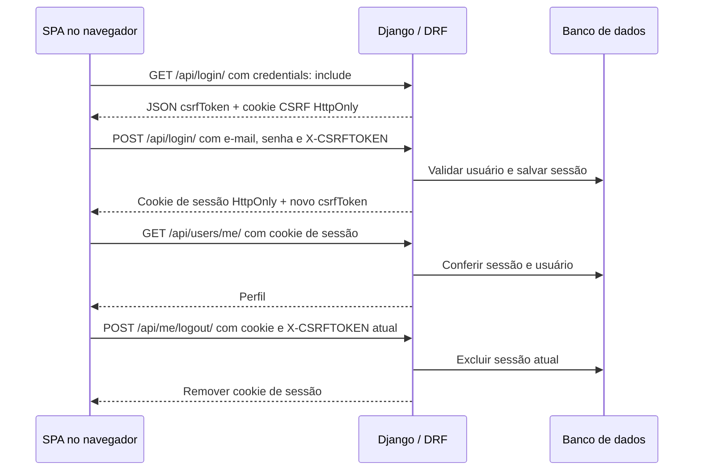
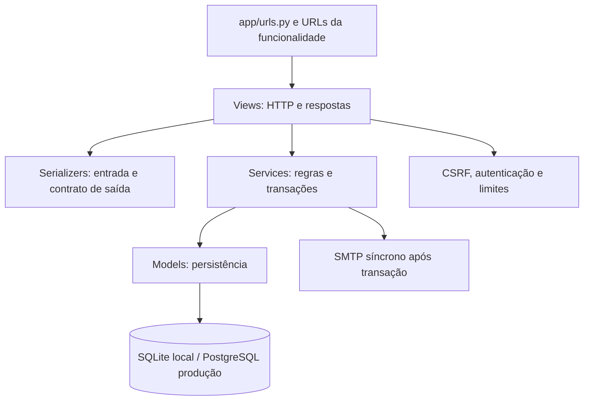

# Template Django REST para SPAs

Backend para cadastro, login, recuperação de senha e manutenção da própria conta, usando Django e Django REST Framework (DRF). O frontend é separado: você pode integrar uma SPA em Vue ou outro framework. Este repositório não inclui uma aplicação frontend.

**Público-alvo:** quem conhece HTTP, Python, fundamentos de Django e JavaScript, mas ainda não trabalhou com cookies, sessões ou CSRF. Leia a trilha na ordem na primeira vez; depois use o sumário como referência.

## Sumário

1. [Entender como a autenticação funciona](#1-entender-como-a-autenticação-funciona)
2. [Executar a API localmente](#2-executar-a-api-localmente)
3. [Integrar os fluxos na SPA](#3-integrar-os-fluxos-na-spa)
4. [Encontrar e alterar o código](#4-encontrar-e-alterar-o-código)
5. [Executar e entender os testes](#5-executar-e-entender-os-testes)
6. [Publicar com segurança](#6-publicar-com-segurança)
7. [Operar e conhecer os limites](#7-operar-e-conhecer-os-limites)
8. [Atualizar uma instalação antiga](#8-atualizar-uma-instalação-antiga)
9. [Consulta rápida para manutenção e IA](#9-consulta-rápida-para-manutenção-e-ia)

## 1. Entender como a autenticação funciona

### Cookie não é sessão

Uma requisição HTTP não identifica automaticamente quem fez a requisição anterior. Depois de conferir e-mail e senha, o Django cria uma **sessão** no banco de dados e envia seu identificador em um cabeçalho `Set-Cookie`.

O **cookie** é um pequeno dado que o navegador guarda e envia nas próximas requisições à API. Aqui ele contém apenas um identificador opaco: não é a senha, não é um JWT e não contém o perfil da pessoa. O Django consulta a sessão no servidor para identificar o usuário.

| Elemento | Onde fica | Para que serve |
| --- | --- | --- |
| Sessão | Tabela de sessões do Django no banco | Manter o estado do acesso autenticado |
| Cookie de sessão | Navegador; enviado automaticamente à API | Identificar a sessão, sem expor a credencial ao JavaScript |
| Cookie CSRF | Navegador; também HttpOnly neste projeto | Permitir que o servidor confira o token recebido no cabeçalho |
| `csrfToken` do JSON | Memória da SPA | Ser enviado como `X-CSRFTOKEN` nas operações de escrita |

**HttpOnly** impede o JavaScript de ler um cookie por `document.cookie`. Não impede seu envio pelo navegador. **Secure** restringe o envio a HTTPS. **SameSite** controla em quais contextos entre sites o cookie pode acompanhar a requisição. Esses atributos não são intercambiáveis.

A sessão dura **24 horas a partir do login**, inclusive no admin. Consultar o perfil ou continuar usando a aplicação não renova esse prazo. Não há refresh token: depois de expirar, é necessário entrar novamente.

### Por que CSRF existe mesmo com HttpOnly?

Como cookies acompanham requisições automaticamente, um site malicioso pode tentar provocar uma operação na API usando o navegador de uma pessoa autenticada. Essa classe de ataque se chama **CSRF** (*Cross-Site Request Forgery*).

Para aceitar uma operação de escrita, a API exige um token no cabeçalho `X-CSRFTOKEN`, além do cookie correspondente, e valida a origem quando aplicável. Um site não autorizado não deve conseguir ler o token da API e montar essa requisição válida. Neste projeto, **todo POST exige CSRF, mesmo antes do login**: isso inclui cadastro e recuperação de senha.

A SPA obtém o token no JSON de `GET /api/login/`, não lendo cookies. O token CSRF **não autentica a pessoa sozinho**. O login troca o segredo CSRF; por isso a SPA deve guardar o novo `csrfToken` retornado pelo POST de login. Depois de recarregar a página, faça o GET novamente.



HttpOnly e CSRF não eliminam **XSS**: se um script malicioso executar dentro da SPA, ainda poderá agir como a pessoa. Evite HTML não confiável e mantenha as dependências do frontend atualizadas. Nunca copie o cookie de sessão para `localStorage` ou `sessionStorage`.

### Origem, site e CORS são coisas diferentes

- **Origem** combina protocolo, host e porta. `http://localhost:5173` e `http://localhost:8000` são origens diferentes.
- **Site**, para a política de cookies, considera o protocolo e o domínio registrável; a porta não o distingue. `https://app.exemplo.com` e `https://api.exemplo.com` são origens diferentes, mas pertencem ao mesmo site.
- **CORS** permite que JavaScript de uma origem autorizada leia respostas de outra origem. Com cookies, a API precisa permitir a origem explicitamente e aceitar credenciais; a SPA também precisa usar `credentials: "include"`.
- **CSRF** protege operações, enquanto **autenticação** identifica o usuário. CORS não substitui nenhum dos dois, nem impede clientes externos de chamar a API.

Hospedar frontend e API em provedores diferentes não exige usar sites diferentes: ambos podem ter subdomínios do mesmo domínio próprio. Essa é a opção que evita depender de cookies de terceiros.

**Entre sites distintos**, `SameSite=None; Secure` e CORS são necessários, mas não garantem que o navegador aceite o cookie. Valide os navegadores-alvo antes de escolher os domínios de produção. Não existe fallback para tokens em armazenamento JavaScript.

## 2. Executar a API localmente

Requisitos: **Python 3.14 e PDM**. No caminho mínimo, o projeto usa SQLite e envia e-mails ao terminal; não precisa de PostgreSQL, Redis, fila ou Docker.

> Os comandos abaixo são para uma instalação nova. Se você já tem dados de uma versão anterior, leia [Atualizar uma instalação antiga](#8-atualizar-uma-instalação-antiga) antes de aplicar migrações.

Antes de executar os comandos locais ou o Compose, prepare manualmente um arquivo `.env` na raiz do repositório, sem versioná-lo. Os scripts abaixo exigem que esse arquivo exista. No desenvolvimento mínimo ele pode ficar vazio: SQLite, e-mail de terminal e origens locais já estão definidos em `app/settings/dev.py`. Para produção, preencha as variáveis da [etapa 6](#6-publicar-com-segurança).

Na raiz do repositório:

```bash
pdm sync -G dev
pdm run migrate
pdm run dev
```

O `pdm.lock` já está atualizado. `pdm sync` instala as versões travadas; não execute `pdm lock` como parte rotineira do onboarding.

| Endereço ou recurso | O que esperar |
| --- | --- |
| `http://localhost:8000/api/login/` | JSON com `csrfToken`; não realiza login |
| `http://localhost:8000/api/docs/urls/` | Swagger com campos, respostas e operações da API |
| `http://localhost:8000/api/docs/schema/` | Schema OpenAPI para ferramentas |
| `http://localhost:8000/admin/` | Admin do Django; crie uma conta com `pdm run python manage.py createsuperuser` |
| `db.sqlite3` | Banco local persistente; parar o servidor não apaga os dados |
| Terminal do servidor | E-mails e códigos locais; use apenas contas de teste |

A raiz `/` não tem uma página de aplicação; um `404` ali não significa que a API está fora do ar. Abra `/api/login/` para conferir.

Os scripts `dev`, `migrate`, `check` e `cleanup` carregam `.env` pelo PDM e selecionam explicitamente `app.settings.dev`, mesmo que o arquivo ou o terminal indique outro perfil. Esse perfil usa uma chave pública de desenvolvimento e cookies adequados a HTTP local. **Nunca publique esse perfil.** Carregar variáveis de produção não substitui as configurações fixas de `dev.py`. O Django chamado diretamente não carrega `.env` automaticamente.

Para uma SPA local, use `http://localhost:5173` ou `http://localhost:3000`. Não misture `localhost` com `127.0.0.1` no navegador. Caso use outra origem, ajuste `CORS_ALLOWED_ORIGINS` e `CSRF_TRUSTED_ORIGINS` em `app/settings/dev.py`.

**Docker é uma alternativa, não um segundo passo obrigatório:** `pdm run dev:up`, `pdm run dev:logs` e `pdm run dev:down`. O contêiner compartilha o código e o SQLite com a pasta do projeto e aplica migrações ao iniciar. Não execute migrações concorrentes nesse arquivo. Ajuste `LOCAL_UID`/`LOCAL_GID` no ambiente do terminal se necessário. O fluxo Docker não foi executado na validação local desta revisão.

## 3. Integrar os fluxos na SPA

### Preparar CSRF e entrar

O exemplo abaixo roda no contexto da sua SPA local. `email` e `password` são os valores do formulário, não credenciais a gravar no código. Em produção, substitua a URL da API por seu endereço HTTPS.

```javascript
const API = "http://localhost:8000";

const bootstrap = await fetch(`${API}/api/login/`, {
  credentials: "include",
  cache: "no-store",
});
if (!bootstrap.ok) throw new Error("Não foi possível preparar o CSRF");
let { csrfToken } = await bootstrap.json();

const login = await fetch(`${API}/api/login/`, {
  method: "POST",
  credentials: "include",
  headers: { "Content-Type": "application/json", "X-CSRFTOKEN": csrfToken },
  body: JSON.stringify({ email, password }),
});
const result = await login.json();
if (!login.ok) throw new Error(result.detail || "Não foi possível entrar");
csrfToken = result.csrfToken; // o login troca o segredo CSRF

const profile = await fetch(`${API}/api/users/me/`, {
  credentials: "include",
});
if (!profile.ok) throw new Error("Sessão indisponível; entre novamente");
const user = await profile.json();
```

O navegador guarda e envia os cookies; o código JavaScript cuida apenas do token CSRF. No Vue, esse token pode ficar no estado em memória, sem persistência. No Axios, use `withCredentials: true` e envie explicitamente `X-CSRFTOKEN`; não dependa de ele ler o cookie CSRF, que pertence à API e também é HttpOnly.

Para sair, usando o token atual:

```javascript
const logout = await fetch(`${API}/api/me/logout/`, {
  method: "POST",
  credentials: "include",
  headers: { "X-CSRFTOKEN": csrfToken },
});
if (!logout.ok) throw new Error("Não foi possível sair");
// Agora limpe o perfil exibido e o estado autenticado da SPA.
```

Se a página recarregar, o cookie de sessão pode continuar válido, mas a variável `csrfToken` não existe mais: repita o GET de preparação e consulte o perfil. Outro login ou uma mudança do CSRF em outra aba também pode exigir nova preparação. Não repita operações de escrita automaticamente após erros.

### Cadastrar, recuperar senha e alterar a conta

Para cada POST abaixo, use o mesmo padrão do login: `credentials: "include"`, JSON e `X-CSRFTOKEN`. Faça a preparação mesmo quando a pessoa ainda não estiver autenticada. Os nomes dos campos são parte do contrato; o Swagger detalha validações e formatos de resposta.

| Etapa | Método e caminho | Campos JSON |
| --- | --- | --- |
| Solicitar cadastro | `POST /api/registration/request/` | `email` |
| Confirmar cadastro | `POST /api/registration/confirm/` | `email`, `code`, `name`, `password` |
| Solicitar recuperação | `POST /api/password-reset/request/` | `email` |
| Confirmar nova senha | `POST /api/password-reset/confirm/` | `email`, `code`, `new_password` |
| Solicitar troca de e-mail | `POST /api/email-change/request/` | `new_email`, `password` atual |
| Confirmar troca de e-mail | `POST /api/email-change/confirm/` | `code`, `password` atual |
| Desativar a própria conta | `POST /api/me/deactivate/` | `password` atual |
| Consultar o próprio perfil | `GET /api/users/me/` | Sem corpo |
| Listar usuários ativos | `GET /api/users/list/` | Sem corpo; exclusivo de `is_staff`, paginado |

**Cadastro:** solicite o código, consulte o e-mail (terminal local), confirme e então faça login. Confirmar cadastro não autentica automaticamente. A emissão retorna `201`; a confirmação retorna `200` quando bem-sucedida.

**Recuperação:** solicite o código e confirme com a nova senha. A resposta à solicitação é uniforme para conta desconhecida, inativa ou falha de envio, para não confirmar a existência da conta. Sucesso HTTP não comprova entrega de e-mail. A confirmação invalida todos os acessos; a pessoa deve entrar novamente.

**Troca de e-mail:** exige sessão válida e senha atual nas duas etapas. O código vai para o novo endereço. Confirmar troca invalida todos os acessos e códigos de recuperação antigos. Faça novo login com o novo e-mail.

**Desativação:** exige sessão e senha atual, desativa a conta e invalida todos os acessos. Não equivale à exclusão física dos dados. O cadastro público não reativa contas desativadas que já tenham senha ou privilégios administrativos.

Os códigos de uso único (OTP) têm **seis dígitos ASCII**, expiram em **15 minutos** e são inutilizados depois de **cinco erros**. Envie `code` como string para preservar zeros à esquerda. O banco guarda apenas seu hash. Nova emissão substitui a anterior; confirmação bem-sucedida consome o código. Não existe etapa `verify/` separada.

### Diagnosticar uma resposta inesperada

| Status | Significado e próxima ação |
| --- | --- |
| `400` | Entrada inválida, código inválido/vencido ou senha atual incorreta; apresente os erros dos campos |
| `401` | Autenticação ausente, expirada ou revogada; solicite novo login |
| `403` | CSRF ou permissão; confira token atual, cookies, origem e privilégios, não apenas a senha |
| `404` | Rota inexistente; confira a URL, especialmente endpoints removidos |
| `429` | Limite de tentativas; respeite `Retry-After` |
| `503` | Operação temporariamente indisponível; não informe sucesso ao usuário |

No DevTools, confira a requisição e os avisos de cookie: houve `Set-Cookie`? A chamada seguinte enviou o cookie? O POST tem `X-CSRFTOKEN`? O `Origin` é permitido? O navegador bloqueou cookies de terceiros? Não copie cookies, senhas ou códigos para logs ou chamados de suporte.

## 4. Encontrar e alterar o código

A estrutura é por funcionalidade dentro de uma única aplicação Django, `core`. Não é necessário criar uma aplicação para cada operação nem mover código para novas camadas para começar a contribuir.



| Local | Responsabilidade / quando consultar |
| --- | --- |
| `app/urls.py` | Entrada das rotas e inclusão das funcionalidades |
| `app/settings/{base,dev,prod}.py` | Configuração compartilhada, desenvolvimento e produção |
| `core/auth/` | Login, logout, autenticação de sessão, limites e sinal de expiração |
| `core/{registration,password_reset,email_change}/` | Fluxos de códigos, com `urls`, `views`, `serializers` e `services` |
| `core/users/` | Perfil, lista da equipe e desativação |
| `core/models/` e `core/migrations/` | Usuário, OTPs e evolução do banco |
| `core/admin.py` | Formulários e operações administrativas |
| `core/shared/` | Envio de e-mail, templates, schema, IP e logs de segurança |
| `core/templates/email/` | Versões texto e HTML dos e-mails |
| `core/management/commands/cleanup_auth.py` | Limpeza periódica |
| `tests/` | Cenários HTTP, validações e transações; arquivos agrupados por assunto |
| `deploy/`, `Dockerfile*`, `docker-compose*.yml` | Imagens, proxy e banco para implantação |
| `.github/workflows/ruff.yml` | Lint, formatação, migrações, schema e testes em SQLite/PostgreSQL |

Para entender uma operação, acompanhe **URL → view → serializer/service → model** e leia o teste correspondente. Por exemplo, login começa em `core/auth/urls.py`, passa por `views.py` e `services.py`, usa `core/models/user.py` e é exercitado por `tests/test_auth.py` e `tests/test_sessions.py`.

Ao adicionar uma funcionalidade, siga essa divisão existente, registre suas rotas, descreva o contrato no OpenAPI e acrescente testes do caminho válido e das rejeições. Não reescreva migrações já distribuídas para resolver alterações novas.

## 5. Executar e entender os testes

Depois de instalar as dependências de desenvolvimento:

```bash
pdm run test
pdm run lint
pdm run format --check
pdm run migrations-check
pdm run schema-check
```

`pdm run test` usa `tests.settings`: banco SQLite em memória, e-mail em memória, sem SMTP real nem acesso ao `db.sqlite3` de desenvolvimento. Os clientes HTTP aplicam a verificação de CSRF; as classes de fluxo usam um hash rápido de senha **somente nos testes**. Não transfira essa configuração para a aplicação publicada.

Testes, lint, formatação e verificações de migrações/schema não carregam `.env`. Os scripts de verificação Django selecionam o perfil de testes explicitamente, evitando herdar o perfil de produção do terminal.

| Cobertura | Arquivos de referência |
| --- | --- |
| Preparação CSRF, login e troca de usuário | `test_auth.py` |
| Expiração absoluta, admin, logout e revogação | `test_sessions.py` |
| Fluxo completo com cookies, recarga, origem e preflight CORS | `test_http_flow.py` |
| Contrato das rotas, OpenAPI e validação de OTP | `test_contracts.py` |
| Cadastro, recuperação, e-mail, permissões e desativação | `test_registration.py`, `test_password_reset.py`, `test_email_change.py`, `test_users.py` |
| Identidade por e-mail e preservação de espaços nas senhas | `test_email_identity.py`, `test_password_whitespace.py` |
| Limites, IP e falhas do cache | `test_rate_limit.py`, `test_client_ip.py` |
| Entrega de e-mail, limpeza e logs sem dados sensíveis | `test_email_sender.py`, `test_email_templates.py`, `test_issuance_logs.py`, `test_maintenance_purge.py`, `test_security.py` |
| Estado alterado antes da mutação e concorrência no banco | `test_integration.py` |
| Configuração de produção e imagens | `test_prod_settings.py`, `test_container_config.py` |

O cliente de testes mantém cookies e envia cabeçalhos, mas **não é um navegador**: não aplica SameSite, bloqueio de cookies de terceiros nem a decisão de CORS no cliente. Os testes verificam respostas, cabeçalhos e rejeições no servidor, não compatibilidade real com Chrome, Firefox ou Safari.

Para concorrência, use um **PostgreSQL descartável e dedicado aos testes**, com a configuração sintética de `tests/settings_integration.py`, e execute:

```bash
pdm run test:postgres
```

Esse comando cria e remove um banco de teste; nunca o aponte para produção. O serviço esperado fica em `127.0.0.1:5432`; os parâmetros estão no arquivo de configuração dos testes. A CI provisiona seu próprio serviço PostgreSQL, sem Redis. No SQLite, os três testes que precisam de concorrência PostgreSQL são ignorados explicitamente, não simulados como aprovados.

**Estado da validação:** suíte SQLite aprovada localmente, lock consistente, lint/formatação aprovados, nenhuma migração ausente e schema validado sem avisos. O mantenedor confirmou a aprovação da CI, incluindo a suíte PostgreSQL e os três testes de concorrência. Navegador real, SMTP real, contêineres e restauração de backups ainda exigem validação funcional própria; a aprovação dos testes automatizados não comprova esses cenários.

## 6. Publicar com segurança

Use `app.settings.prod`, PostgreSQL privado e HTTPS. Injete a configuração pelo painel de segredos/variáveis da hospedagem; não grave credenciais no repositório nem na imagem. O perfil valida configurações obrigatórias ao carregar.

Os scripts `compose:dev` e `compose:prod` usam explicitamente `--env-file .env` para a interpolação do Compose; seus atalhos `dev:*` e `prod:*` reutilizam esses comandos. Isso não injeta todas as variáveis do arquivo nos contêineres: cada serviço recebe apenas as declaradas em `environment` no YAML. `pdm run deploy-check` carrega `.env` pelo PDM e executa a verificação de implantação com `app.settings.prod`; `pdm run prod:check` executa a verificação dentro de um contêiner. Nenhum desses comandos valida, sozinho, o funcionamento completo da implantação.

| Variável | Configuração |
| --- | --- |
| `DJANGO_SETTINGS_MODULE` | `app.settings.prod` fora dos contêineres que já o selecionam |
| `SECRET_KEY` | Chave exclusiva, aleatória, com pelo menos 50 caracteres, sem o prefixo de desenvolvimento |
| `ALLOWED_HOSTS` | Hosts da API separados por vírgula, sem protocolo ou `*` |
| `FRONTEND_ORIGINS` | Origens HTTPS explícitas das SPAs, sem caminho/barra final; configura CORS e CSRF |
| `DATABASE_URL` | URL PostgreSQL do usuário da aplicação, sem privilégios de administrador |
| `EMAIL_HOST`, `DEFAULT_FROM_EMAIL` | Servidor SMTP e remetente autorizado |
| `EMAIL_HOST_USER`, `EMAIL_HOST_PASSWORD` | Credenciais SMTP fornecidas pelo provedor, quando exigidas |
| `EMAIL_PORT`, `EMAIL_USE_TLS`, `EMAIL_USE_SSL` | Padrão: 587 com STARTTLS; não ative TLS e SSL juntos |
| `TRUST_PROXY_HEADERS`, `NUM_PROXIES` | Confie somente em proxy controlado; informe quantos proxies acrescentam IPs |

Produção usa `__Host-sessionid` e `__Host-csrftoken`: HttpOnly, Secure, `SameSite=None`, caminho `/`, sem `Domain`. A SPA deve se conectar por HTTPS. Não permita acesso público que contorne um proxy cujos cabeçalhos são considerados confiáveis. Em banco gerenciado, configure TLS e validação de certificado conforme o provedor.

### Escolher o caminho de implantação

**PaaS:** inicie Gunicorn com `app.wsgi:application`; configure arquivos estáticos e HTTPS na plataforma. Execute migrações e `collectstatic` uma vez no processo de release, antes de liberar as réplicas. A imagem não aplica migrações ao iniciar cada processo web.

**VPS com Compose:** a stack incluída é para host único e contém PostgreSQL, release, aplicação e Nginx. Injete também `POSTGRES_PASSWORD`, `APP_DB_PASSWORD` e uma `DATABASE_URL` coerente com o usuário da aplicação (`template_auth` por padrão). Inclua `localhost` em `ALLOWED_HOSTS` para a verificação interna. Prepare certificados válidos e renovação externamente; `TLS_DIR` aponta ao diretório com `fullchain.pem` e `privkey.pem`. Somente o Nginx publica portas. Use `pdm run prod:up` e `pdm run prod:logs` após preparar a configuração. Não inicie essa stack inteira para consumir banco gerenciado sem adaptar a orquestração.

Antes de atender contas reais, valide os fluxos da SPA nos domínios/navegadores escolhidos, SMTP, concorrência PostgreSQL e backup com restauração. A verificação HTTP dos contêineres não comprova banco disponível ou entrega de e-mail. Volumes não substituem backups; nunca use `down -v` com dados que precise preservar.

## 7. Operar e conhecer os limites

- **Limpeza:** agende `python manage.py cleanup_auth --settings=app.settings.prod` na hospedagem, por exemplo diariamente. Remove cadastros incompletos elegíveis após 48 horas, códigos vencidos e sessões expiradas. Preserva contas com senha definida ou privilégios administrativos e reavalia candidatos sob bloqueio antes de excluir.
- **E-mail:** SMTP é síncrono, depois do bloco de transação do banco. Cada espera de rede tem timeout de dez segundos; não é um prazo total garantido. Não há fila nem retentativa durável. Falha de envio invalida o código emitido quando a limpeza no banco consegue executar. Pode ser necessário pedir outro código.
- **Enumeração:** a recuperação retorna resposta uniforme, mas SMTP síncrono pode revelar diferenças de latência. Não há promessa de tempo constante.
- **Limites:** login por IP e IP/e-mail, emissão por IP/e-mail, confirmação por IP e senha atual por usuário. Valores e janelas ficam em `core/auth/rate_limit.py`; falhas de acesso ao cache retornam indisponibilidade, não liberação irrestrita.
- **Cache local:** os contadores são por processo, perdem-se em reinícios e podem ser expulsos por memória. Mais workers ampliam a margem efetiva. Não é limitação global ou estrita. As cinco tentativas do OTP permanecem no banco. Proteja o admin separadamente: esses limitadores são da API.
- **Réplicas:** sessões no PostgreSQL dispensam afinidade no balanceador, mas não tornam os limitadores distribuídos. Meça consultas, latência e carga antes de dimensionar.
- **Revogação:** recuperação de senha, confirmação de outro e-mail e desativação invalidam os acessos na próxima autenticação; não desfazem operações já autorizadas e em andamento. Mutações sensíveis bloqueiam e conferem novamente o usuário. SQLite não reproduz os bloqueios do PostgreSQL.
- **Logs e cache HTTP:** registre apenas evento/resultado, nunca corpos de requisições, senhas, OTPs, cookies ou identificadores de sessão. Não faça cache de `/api/` nem de `/admin/` no proxy/CDN. Não há tabela ou API de auditoria.

## 8. Atualizar uma instalação antiga

**Esta revisão é incompatível com a versão JWT e não oferece migração automática de bancos antigos.** O commit `4990247` substituiu o histórico anterior de migrações por uma nova `core/migrations/0001_initial.py`. Portanto, os antigos passos `0005`/`0006` descritos em revisões passadas da documentação não estão disponíveis aqui.

Não execute simplesmente `migrate` sobre um banco que tenha aplicado a antiga `0001`, não apague seu histórico e não use `--fake` como correção genérica: o Django pode considerar a migração aplicada mesmo que a estrutura real não corresponda à nova definição.

Para preservar dados, faça backup e planeje uma migração específica, em uma cópia isolada, a partir da versão realmente instalada. Identifique diferenças de schema, normalização/colisões de e-mail e dados que precisam ser preservados, e valide restauração antes da troca. Um ambiente novo deve começar com banco novo; não apague o banco antigo para viabilizar o onboarding.

JWTs anteriores não autenticam. Foram removidos refresh, opção `remember_me`, dispositivos/sessões consultáveis pela API, revogação geral pela API, endpoints `verify/`, auditoria consultável e `/manual/`. A suíte atual cobre o contrato de sessão; não há necessidade de reinstalar JWT, Celery ou Redis para executar os testes.

## 9. Consulta rápida para manutenção e IA

Este é o resumo técnico da mesma trilha, não uma especificação paralela nem instruções de governança de agentes.

- **Entrada:** `app/urls.py` → `core/<funcionalidade>/urls.py` → `views.py` → `serializers.py` e `services.py` → `core/models/`.
- **Autenticação:** `core/auth/authenticate.py` deriva de `SessionAuthentication` e exige CSRF também em mutações públicas. Sem JWT.
- **Expiração:** `core/auth/signals.py`, sinal `user_logged_in`, fixa login + 24 horas em API e admin; não há renovação por atividade.
- **Hash da sessão:** `User._get_session_auth_hash` inclui senha, e-mail, estado ativo e `session_version`.
- **Revogação geral interna:** `SessionService.revoke_all_sessions` incrementa a versão atomicamente, sem varrer sessões; registros antigos permanecem até a limpeza.
- **Admin:** alterações de e-mail/estado via `UserAdmin` incrementam a versão. Não existe admin de dispositivos JWT.
- **Concorrência:** `require_unchanged_user` revalida estado sob bloqueio; `select_for_update` exige PostgreSQL para reproduzir a proteção real.
- **CSRF:** GET `/api/login/` retorna `{csrfToken}` sem cache; POST retorna `{detail, csrfToken}` rotacionado; SPA usa `credentials: include` e `X-CSRFTOKEN`.
- **Identidade:** e-mails normalizados integralmente para minúsculas; constraint protege escritas diretas. Senhas preservam espaços; vazias/só espaços são rejeitadas.
- **OTP:** seis dígitos ASCII, hash, 15 minutos, cinco erros, consumo transacional. Erro de código inválido é levantado após o bloco atômico para persistir tentativas.
- **SMTP:** `core/shared/email_token_sender.py`, síncrono após bloco transacional, com prazo de expiração conferido antes de enviar; sem fila/retry durável.
- **Logs:** `core/shared/security.py` aceita apenas eventos/resultados fixos; falhas de emissão/limpeza registram classe da exceção, não a mensagem original.
- **Limites:** `core/auth/rate_limit.py`, cache local por processo; sem garantia global. Falhas do cache retornam `503`.
- **Operação:** scheduler externo chama `cleanup_auth`; sem Redis/Celery/Beat. Django direto não carrega `.env`; scripts locais de desenvolvimento e `deploy-check` carregam pelo PDM, e Compose usa `--env-file .env`.
- **Implantação:** `app.settings.prod`, PostgreSQL, HTTPS; release único para migrações/static; web não root. Compose é VPS de host único, não provisionamento de PaaS.
- **Verificação:** `pdm run test`, `lint`, `format --check`, `migrations-check`, `schema-check`; não carregam `.env` e as verificações Django selecionam `tests.settings`.
- **PostgreSQL:** `pdm run test:postgres`, somente com serviço descartável dedicado; usa `tests.settings_integration`, sem carregar `.env`.
- **Evidências e limites:** SQLite validado localmente; aprovação da CI e da suíte PostgreSQL confirmada pelo mantenedor. Testes HTTP não são navegador; Docker, SMTP real e restauração de backups precisam de validação própria.
- **Migrações antigas:** histórico refeito antes desta revisão; não aplicar automaticamente sobre bancos existentes. Veja a etapa 8.
