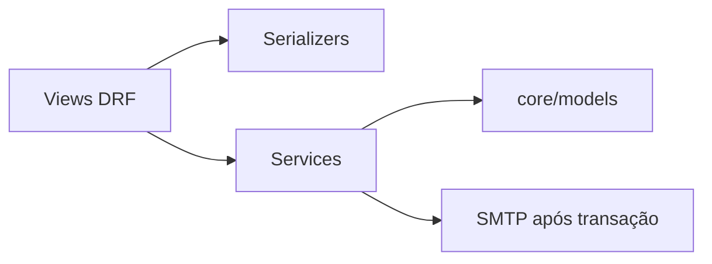

# Referência técnica da aplicação

Público-alvo: desenvolvedores e agentes de IA. Consulta rápida do código atual, não um backlog de funcionalidades.

## Mapa

| Área | Arquivos principais |
| --- | --- |
| Configuração | `app/settings/{base,dev,prod}.py` |
| Rotas | `app/urls.py`, `core/<feature>/urls.py` |
| Autenticação | `core/auth/{authenticate,services,views,signals}.py` |
| Limites locais | `core/auth/rate_limit.py` |
| Conta | `core/users/{services,views}.py`, `core/admin.py` |
| Códigos | `core/{registration,password_reset,email_change}/` |
| Persistência | `core/models/`, `core/migrations/` |
| E-mail | `core/shared/{email_token_sender,email_templates}.py`, `core/templates/email/` |
| Logs | `core/shared/security.py` |
| Manutenção | `core/management/commands/cleanup_auth.py` |

## Sessões e CSRF

- Sessão nativa no PostgreSQL, não JWT. SQLite somente no desenvolvimento simples.
- O sinal `user_logged_in` define uma data absoluta de expiração: login + 24 horas, incluindo admin.
- `User._get_session_auth_hash` inclui senha, e-mail, estado ativo e `session_version`.
- `SessionService.revoke_all_sessions` incrementa a versão atomicamente; não varre sessões.
- Recuperação de senha, troca de e-mail e desativação invalidam acessos. Alterações de e-mail/estado pelo admin também incrementam a versão.
- Mutações sensíveis bloqueiam o usuário e comparam o estado atual com o autenticado.
- A invalidação é conferida na autenticação seguinte; não cancela requisições em andamento.
- `CustomAuthentication` deriva de `SessionAuthentication` e exige CSRF também em mutações públicas.
- GET `/api/login/` retorna `{csrfToken}` e não pode ser cacheado.
- POST `/api/login/` recebe e-mail/senha, emite cookie e retorna `{detail, csrfToken}` rotacionado.
- A SPA usa credenciais incluídas e `X-CSRFTOKEN`; nunca lê a sessão nem guarda tokens em armazenamento persistente.
- Produção: `__Host-sessionid` e `__Host-csrftoken`, HttpOnly, Secure, SameSite=None, sem Domain.
- CORS usa `django-cors-headers`; `FRONTEND_ORIGINS` configura CORS e origens CSRF explícitas.
- Cookies entre sites dependem do navegador; não existe fallback em localStorage.

## Fluxos de conta

- Cadastro, recuperação e troca de e-mail têm somente request/confirm.
- OTP: seis dígitos ASCII, hash, 15 minutos, cinco erros; confirmação consome em transação.
- Tentativas incorretas persistem: a resposta de código inválido é levantada depois do bloco atômico.
- E-mails completos são normalizados para minúsculas; a constraint protege escritas diretas.
- A migração `0005` aborta em colisões de identidade, sem unir contas automaticamente.
- Troca de e-mail exige senha atual e invalida códigos de recuperação anteriores.
- Senhas preservam espaços; entradas vazias ou só com espaços são rejeitadas.
- SMTP é síncrono, fora do bloco atômico; timeout por espera de rede, sem fila ou retry durável.
- Falhas de emissão/limpeza registram operação e classe da exceção, sem mensagem original.
- Falha de envio invalida o código emitido quando o banco permite a limpeza.
- Recuperação mantém resposta uniforme, mas não promete tempo constante com SMTP síncrono.
- Logs de eventos contêm apenas valores fixos; não há tabela nem API de auditoria.

## Operação

- Cache local: limites por processo, sujeitos a reinícios e expulsão; não é proteção distribuída.
- Limites usam IP, e-mail ou usuário conforme a operação; OTP também possui contador no banco.
- Falhas de consulta/incremento dos limitadores retornam indisponibilidade, não autorização irrestrita.
- Sem Redis, Celery, Beat ou perfil integrado. Scheduler externo chama `cleanup_auth`.
- A limpeza bloqueia e reavalia usuários abandonados; preserva contas com senha e contas administrativas.
- Datas de expiração são conferidas no servidor; sessões revogadas podem ocupar a tabela até a limpeza.
- Configuração de produção é injetada; não há carregamento automático de arquivos de ambiente.
- Confiança em cabeçalhos de proxy é opt-in fora do Compose. `NUM_PROXIES` deve refletir a cadeia real.
- Contêiner web é não root; migração/static collection ficam no serviço de release, não em cada réplica.
- Compose de produção é para host único com Nginx e PostgreSQL privados, não provisionamento de PaaS.
- `deploy/nginx/direct.conf` encerra TLS na origem; certificados e renovação são externos.
- Verificações HTTP não comprovam dependências saudáveis nem entrega de e-mail.

## Estado da transição

- `0006_native_sessions` adiciona versão de autenticação e remove UserSession/AuditLog: dados dessas tabelas serão perdidos.
- Históricos de migração preservados; JWTs anteriores deixam de ser aceitos.
- `pdm.lock` ainda precisa ser atualizado pelo mantenedor antes de sync/build/CI.
- Testes antigos permanecem sem alterações e referenciam contratos removidos; CI temporariamente só faz lint.
- A refatoração foi analisada estaticamente; Django, migrações, SMTP, contêineres e navegadores não foram executados.
- Validação futura: autorização/CSRF, expiração absoluta, revogação, falhas de envio, concorrência PostgreSQL e cookies entre sites.
