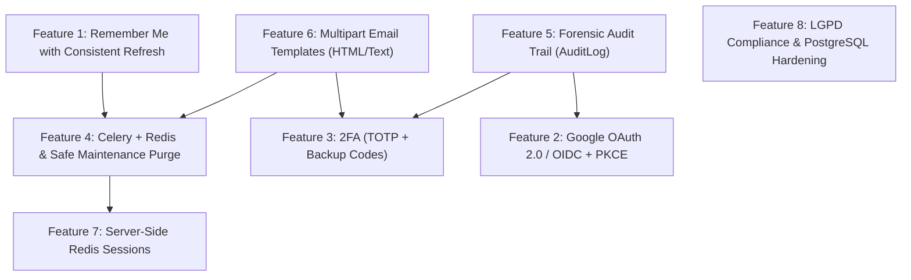

# Planned Features & Future Security Architecture Playbook

> **Target Audience:** Autonomous AI coding agents & system architects.  
> **Repository:** `template-django-rest`  
> **Core Constraint:** Subordinate to [AGENTS.md](../AGENTS.md). Features 1, 4a/4b, 5a/5b, 6a, and 7 are implemented; all remaining work is planning only. Preserve cookie-only auth, CSRF enforcement, `core/models/` entity encapsulation, and `ATOMIC_REQUESTS=False`.

---

## 1. Architectural Invariants

1. **Cookie-Only Authentication:** Every authentication path (OAuth, 2FA, Remember Me) concludes by issuing HttpOnly `access_token` and `refresh_token` cookies tied to an active `UserSession`.
2. **Entity Encapsulation:** All Django ORM models reside strictly within `core/models/`. Feature packages (`core/<feature>/`) contain only `views.py`, `serializers.py`, `services.py`, and `urls.py`.
3. **Decoupled External I/O:** Network operations (SMTP delivery, OIDC token exchange, webhooks) must never execute synchronously inside active `transaction.atomic()` blocks.
4. **Contract Invariance:** Every new endpoint must be simultaneously registered in `tests/test_contracts.py` under the appropriate `public` or `protected` sets.

---

## 2. Dependency Graph & Execution Sequence



**Recommended Implementation Order:**
1. `Feature 1` (Remember Me with Consistent Refresh)
2. `Feature 6` (Multipart Email Templates & In-App Notifications)
3. `Feature 5` (Forensic Audit Trail with `AuditLog`)
4. `Feature 4` (Celery + Redis Async Tasks & Safe Maintenance Purge)
5. `Feature 3` (Two-Factor Authentication - TOTP RFC 6238)
6. `Feature 2` (Google OAuth 2.0 / OIDC + PKCE)
7. `Feature 7` (Server-Side Redis Sessions)
8. `Feature 8` (Production Hardening & LGPD Compliance)

---

## 3. Technical Feature Specifications

---

### Feature 1: Remember Me — IMPLEMENTED

- Optional login `remember_me` persists on `UserSession`. Standard refresh inactivity 1 day, remembered inactivity 7 days; both absolute limits remain 30 days from creation. Do not reduce the standard absolute cap to 7 days without approval.
- Login and rotation cap refresh expiration at `min(now + inactivity, created_at + absolute)`; access expiration also respects absolute cap. Cookie `max_age` uses remaining JWT lifetime. Rotation preserves the stored flag and outstanding-token expiry; replacement login sets a new flag. Keep reuse detection, CSRF, paths, cache invalidation and response body unchanged.

---

### Feature 2: Google Social Authentication (OAuth 2.0 / OIDC + PKCE)

- **Objective:** Federated identity login adhering to cookie-only auth, preventing Account Takeover (ATO) and Pre-Account DoS.
- **Package & Entity:**
  - Package: `core/oauth/` (`views.py`, `serializers.py`, `services.py`, `urls.py`).
  - Model: `core/models/oauth.py` (`OAuthAccount` with `user`, `provider="google"`, `provider_user_id` [sub], `created_at`).
  - Endpoints: `GET /api/auth/google/start/`, `POST /api/auth/google/callback/`.
- **Security Mitigations:**
  1. **Anti-Pre-Account Takeover / Anti-DoS Policy:**
     - If Google returns `email_verified=True` and matching local user has `is_active=False` (unconfirmed registration attempt): Activate user, link `OAuthAccount`, and log in immediately. (Prevents attackers from locking users out via unconfirmed email registration).
     - If matching user exists with `is_active=True` and password set (unlinked account): Reject direct OAuth with HTTP 409 Conflict: `{"detail": "Account exists. Please log in with password and link Google in settings."}`.
     - If no matching user: Create `User(is_active=True, email=email, name=name)` and link `OAuthAccount`.
  2. **PKCE & Cryptographic State Binding:**
     - Backend generates `state` and `code_verifier`/`code_challenge` (RFC 7636).
     - Signed hash of `state` and `code_verifier` is stored in an ephemeral HttpOnly cookie (`oauth_challenge`, TTL 5m).
     - Callback verifies cookie signature and passes `code_verifier` to Google's token endpoint, guaranteeing the client completing the exchange initiated the flow.
  3. **Session Emission:** Complete via `AuthService.create_user_session()`, issuing standard HttpOnly `access_token` and `refresh_token` cookies.
- **Required Tests:** Mock OIDC token endpoint; reject invalid/tampered `state` (403); reject unlinked active accounts (409); successfully activate pending inactive accounts.

---

### Feature 3: Two-Factor Authentication (2FA - TOTP RFC 6238 + Backup Codes)

- **Objective:** Add strong second-factor authentication using standard RFC 6238 TOTP (Google Authenticator, Bitwarden) and hashed backup codes. SMS is excluded due to SIM swap risks (NIST SP 800-63B).
- **Package & Entity:**
  - Package: `core/two_factor/` (`views.py`, `serializers.py`, `services.py`, `urls.py`).
  - Models in `core/models/two_factor.py`:
    - `TwoFactorDevice(user, secret_encrypted, is_confirmed, created_at)`
    - `TwoFactorBackupCode(user, code_hash, used, used_at)`
  - Dependencies: `pyotp>=2.9.0`, `cryptography>=43.0.0`.
- **Flow Implementation:**
  1. **Setup (`POST /api/2fa/setup/`):** Authenticated. Generates 160-bit base32 secret, encrypted at rest using AES-256-GCM. Returns `otpauth://` URI and plaintext secret.
  2. **Confirm Setup (`POST /api/2fa/confirm-setup/`):** Authenticated. Validates first TOTP code. Activates device, generates 10 backup codes, stores hashes via `make_password`, and returns plaintext backup codes once.
  3. **Login Interception:** If `user.two_factor.filter(is_confirmed=True).exists()`, `LoginView` withholds session cookies and returns HTTP 200:
     ```json
     {
         "two_factor_required": true,
         "ticket": "<ephemeral_signed_jwt_5m>"
     }
     ```
  4. **Verification (`POST /api/2fa/verify/`):** Public route with CSRF enforcement (`enforce_csrf`). Consumes `ticket` and TOTP code (or backup code). Mitigates replay attacks by caching consumed timestamps for 90s. On success, issues active `UserSession` and cookies.
  5. **Secure Deactivation (`POST /api/2fa/disable/`):** Authenticated. **Mandatory OWASP Requirement:** Requires current `password` or valid TOTP code in payload. Revokes device and invalidates backup codes.
- **Required Tests:** Device activation; 2FA login challenge & resolution; replay rejection; backup code single-use; 400 error on deactivation without password.

---

### Feature 4a: Async Mail — IMPLEMENTED

- `celery[redis]>=5.6,<5.7` requires Redis Python client `>=6.2,<6.5` (Kombu constraint). Redis broker on cache DB + 2 with verified TLS for credentialed `rediss://`; `redis://` only on private networks. Require explicit worker `DJANGO_SETTINGS_MODULE`; use JSON, ignore results, retry broker connection on startup.
- Render subject and text/HTML before enqueue on commit; task carries only rendered data, expires no later than issued code, redacts argument representations, retries SMTP/network failures only, and logs permanent failures without secrets. Queue failure removes the issued code and returns 503 for registration/email change; password-reset response remains uniform 200. Accepted deliveries cannot retroactively change HTTP responses.
- Dev/test eager tasks; test harness propagates task failures to tests.

### Feature 4b: Maintenance Purge — IMPLEMENTED

- Single Celery Beat process dispatches `core/registration/tasks.py:daily_maintenance_purge_task` at 03:00 application time zone. Batch-delete inactive unconfirmed registrations older than 48 hours with an existing, unused, expired verification; preserve self-deactivated accounts. Revoke and delete active sessions past the standard/remembered absolute cap; delete inactive sessions stale 30 days. Run stock Simple JWT `flushexpiredtokens` (the stock command is not batched). Delete old audit records only with positive configured `AUDIT_RETENTION_DAYS`; default `None` retains them until a legal retention decision. Return aggregate counts without PII.

---

### Feature 5a/5b: Audit Trail (`AuditLog`) — IMPLEMENTED AT APPLICATION LAYER

- **Objective:** Log security events without credentials or raw unknown-account emails. Application-level read-only API does not provide tamper evidence or certify legal compliance; enforce PostgreSQL append-only roles/retention policy in Feature 8.
- **Package & Entity:**
  - Package: `core/audit/` (`services.py`, `serializers.py`, `views.py`, `urls.py`); no new admin or middleware.
  - Model: `core/models/audit_log.py`.
- **Model Definition:**
  ```python
  class AuditLog(models.Model):
      # SET_NULL preserves audit trail if user account is deleted
      user = models.ForeignKey(
          settings.AUTH_USER_MODEL,
          on_delete=models.SET_NULL,
          null=True,
          blank=True,
          related_name="audit_logs",
      )
      user_uuid_snapshot = models.UUIDField(null=True, blank=True)
      event_type = models.CharField(max_length=64, db_index=True)
      ip_address = models.GenericIPAddressField(null=True, blank=True, db_index=True)
      user_agent = models.CharField(max_length=512, blank=True)
      session_id = models.IntegerField(null=True, blank=True)
      status = models.CharField(max_length=32)  # SUCCESS, FAILURE, BLOCKED
      details_json = models.JSONField(default=dict, blank=True)
      created_at = models.DateTimeField(auto_now_add=True, db_index=True)

      class Meta:
          ordering = ["-created_at"]
          indexes = [
              models.Index(fields=["event_type", "created_at"]),
              models.Index(fields=["ip_address", "created_at"]),
          ]
  ```
- **Strict Data Blacklist (Never Log):** Passwords, password hashes, 6-digit OTP codes, TOTP secrets, backup codes, JWT tokens, CSRF tokens, session cookies.
- **Access:** Existing `/admin/` remains unchanged. `GET /api/audit/` is staff-only, paginated, and read-only; `AuditLog` is not registered in Django admin. Service filters details by event-specific key and allowed value, parses/sanitizes user-agent, snapshots the UUID and logs audit-write errors without interrupting authentication. BLOCKED events are deduplicated by cache key. Failure events are recorded outside business transactions. Full behavioral tests verify audit logging, sanitization, authorization, and resilience in `tests/test_audit.py`.

---

### Feature 6: Multipart Email Templates & In-App Security Notifications

- **Objective:** Responsive HTML + plaintext transactional emails and in-app notifications for security events.
- **Directory & Templates:**
  - Location: `core/templates/email/` (compatible with `APP_DIRS: True`).
  - Subtemplates: `verification_code.{html,txt}`, `password_reset.{html,txt}`, `email_change.{html,txt}`, `security_alert.{html,txt}`.
- **In-App Notification Model:**
  ```python
  class Notification(models.Model):
      user = models.ForeignKey(settings.AUTH_USER_MODEL, on_delete=models.CASCADE, related_name="notifications")
      title = models.CharField(max_length=255)
      message = models.TextField()
      category = models.CharField(max_length=64, default="security")
      read_at = models.DateTimeField(null=True, blank=True)
      created_at = models.DateTimeField(auto_now_add=True)
  ```
- **Endpoints:** `GET /api/notifications/` (paginated, `user=request.user`), `POST /api/notifications/<id>/read/`, `POST /api/notifications/read-all/`.
- **Automated Security Triggers:** New IP/device login, password changed, email changed, 2FA enabled/disabled.

---

### Feature 7: Server-Side Redis Sessions — DONE

- **Contract:** `UserSession` in DB is authoritative; positive-only cache-aside on `sessions` alias. Access/refresh JWTs contain `session_id`; legacy access tokens without it use SQL. Key `session:{session_id}` holds access JTI and user ID. On miss/cache error, check DB; log cache errors; populate only a valid binding. User lookup still queries SQL.
- **Configuration:** Dev/test locmem `sessions`; prod native RedisCache uses `REDIS_URL` DB index + 1 and distinct `KEY_PREFIX=sessions`. Set `SESSION_CACHE_TTL=60` seconds by default; cap each entry by access lifetime and remaining token expiry. Redis must support multiple DB indexes.
- **Invalidation:** Logout, revoke-all, self-deactivation, password reset, confirmed email change, other-session DELETE, login replacement, and refresh rotation schedule cache deletion with `transaction.on_commit()`; mass revoke reads IDs before update. Failed invalidation leaves bounded staleness for at most TTL, not immediate revocation. No per-user sets, raw Redis client, or django-redis dependency.
- **Verification:** SQL query count, cache miss/failure, invalid binding, legacy token upgrade, and revocation covered by `tests/test_session_cache.py`; full `pdm run verify` passed with 85 tests. Validate Redis multi-DB support, locking, and invalidation behavior in the production topology.

---

### Feature 8: Production Hardening & LGPD Compliance

- **Objective:** Enterprise production readiness, dedicated PostgreSQL connection pooling, and compliance with data subject rights.
- **Specifications:**
  1. **Data Portability (LGPD Art. 18, V):** Endpoint `GET /api/me/export/` requiring reauthentication (password). Serializes user profile, active sessions, and audit entries into structured JSON.
  2. **Production Database Driver:** Add `psycopg[binary]>=3.2.0` to `pyproject.toml`. Update `app/settings/prod.py` to parse `DATABASE_URL` via PostgreSQL engine.
  3. **Automated CVE Auditing in CI:** Integrate `pip-audit` in `[tool.pdm.scripts]` and add step to GitHub Actions CI workflow to reject PRs with known dependency CVEs.

---

## 4. Regulatory & Standards Traceability Matrix

| Feature | OWASP ASVS / Top 10 | LGPD / Marco Civil | Open Standard |
| :--- | :--- | :--- | :--- |
| **Remember Me** | V3.3 Session Management | Art. 6 (Security) | RFC 6749 (Refresh) |
| **Google OAuth** | V2.7 OIDC / Federation | Art. 7 (Consent) | RFC 7636 (PKCE), RFC 6749 |
| **2FA TOTP** | V2.8 Authenticator Assurance | Art. 46 (Technical Measures) | RFC 6238 (TOTP) |
| **Celery Purge** | V8 Data Protection | Art. 18, VI (Deletion) | 12-Factor App (Backing Services) |
| **AuditLog** | V10 Malicious Activity / Logging | Marco Civil Art. 15 (Access Logs) | OWASP Logging Cheat Sheet |
| **Notifications** | V2.1 Incident Response | Art. 48 (Security Incidents) | W3C Notifications |
| **Redis Sessions** | V3.1 Session Security | Art. 46 (Resilience) | Redis In-Memory Patterns |
| **Data Export** | V8 Data Protection | Art. 18, V (Portability) | JSON Data Transfer Standards |
