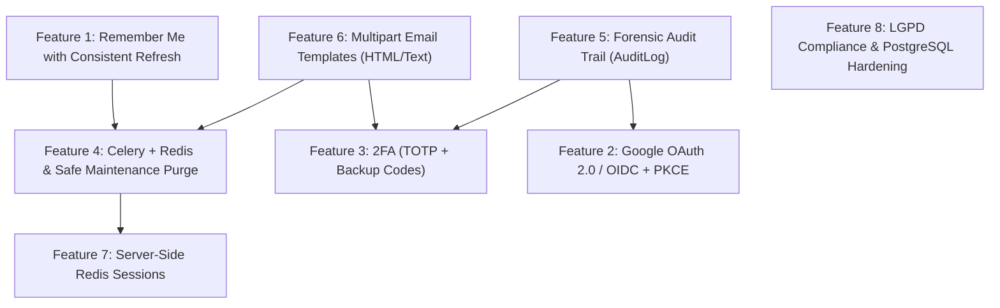

# Planned Features & Future Security Architecture Playbook

> **Target Audience:** Autonomous AI coding agents & system architects.  
> **Repository:** `template-django-rest`  
> **Core Constraint:** Subordinate to [AGENTS.md](../AGENTS.md). Strict planning only. Preserve cookie-only auth, CSRF enforcement, `core/models/` entity encapsulation, and `ATOMIC_REQUESTS=False`.

---

## 1. Architectural Invariants

1. **Cookie-Only Authentication:** Every authentication path (OAuth, 2FA, Remember Me) concludes by issuing HttpOnly `access_token` and `refresh_token` cookies tied to an active `UserSession`.
2. **Entity Encapsulation:** All Django ORM models reside strictly within `core/models/`. Feature packages (`core/<feature>/`) contain only `views.py`, `serializers.py`, `services.py`, and `urls.py`.
3. **Decoupled External I/O:** Network operations (SMTP delivery, OIDC token exchange, webhooks) must never execute synchronously inside active `transaction.atomic()` blocks.
4. **Contract Invariance:** Every new endpoint must be simultaneously registered in `tests/test_contracts.py` under the appropriate `public` or `protected` sets.

---

## 2. Dependency Graph & Execution Sequence



**Recommended Implementation Order:**
1. `Feature 1` (Remember Me with Consistent Refresh)
2. `Feature 6` (Multipart Email Templates & In-App Notifications)
3. `Feature 5` (Forensic Audit Trail with `AuditLog`)
4. `Feature 4` (Celery + Redis Async Tasks & Safe Maintenance Purge)
5. `Feature 3` (Two-Factor Authentication - TOTP RFC 6238)
6. `Feature 2` (Google OAuth 2.0 / OIDC + PKCE)
7. `Feature 7` (Server-Side Redis Sessions)
8. `Feature 8` (Production Hardening & LGPD Compliance)

---

## 3. Technical Feature Specifications

---

### Feature 1: "Remember Me" with Consistent Refresh Token Rotation

- **Objective:** Enable an optional 30-day extended session on trusted devices that survives the 15-minute access token rotation cycle on `POST /api/refresh/`.
- **Architecture:**
  1. **Model Persistence:**
     In `core/models/user.py`, add field to `UserSession`:
     ```python
     remember_me = models.BooleanField(
         default=False,
         help_text=_("Whether this session has extended 30-day lifetime."),
     )
     ```
  2. **Login View & Service:**
     - In `core/auth/serializers.py` (`LoginSerializer`): Add `remember_me = serializers.BooleanField(default=False, required=False)`.
     - In `core/auth/services.py` (`AuthService.login_user`): Accept `remember_me`. If `True`, set refresh token lifetime to 30 days (`refresh.set_exp(lifetime=timedelta(days=30))`) and save `UserSession(..., remember_me=True)`.
     - In `core/auth/views.py` (`LoginView.post`): Pass `remember_me` into cookie helper `get_auth_cookie_kwargs(is_refresh=True, remember_me=True)`.
  3. **Refresh Token Rotation (`POST /api/refresh/`):**
     - In `core/auth/services.py` (`SessionService.refresh_tokens`):
       Lock session via `select_for_update()`. Check `session.remember_me`.
       If `session.remember_me` is `True`:
       ```python
       new_refresh = RefreshToken(refresh)
       new_refresh.set_exp(lifetime=timedelta(days=30))
       refresh = str(new_refresh)
       ```
       Return `{"access": access, "refresh": refresh, "remember_me": session.remember_me}`.
     - In `core/auth/views.py` (`CustomTokenRefreshView`): Use `token_data["remember_me"]` to set cookie `max_age=2592000` (30 days) on the rotated `refresh_token`.
- **Required Tests:**
  - Standard login: `max_age=86400` (1 day).
  - Remember-me login: `max_age=2592000` (30 days).
  - Refresh cycle on remember-me session: Rotated cookie retains `max_age=2592000`.

---

### Feature 2: Google Social Authentication (OAuth 2.0 / OIDC + PKCE)

- **Objective:** Federated identity login adhering to cookie-only auth, preventing Account Takeover (ATO) and Pre-Account DoS.
- **Package & Entity:**
  - Package: `core/oauth/` (`views.py`, `serializers.py`, `services.py`, `urls.py`).
  - Model: `core/models/oauth.py` (`OAuthAccount` with `user`, `provider="google"`, `provider_user_id` [sub], `created_at`).
  - Endpoints: `GET /api/auth/google/start/`, `POST /api/auth/google/callback/`.
- **Security Mitigations:**
  1. **Anti-Pre-Account Takeover / Anti-DoS Policy:**
     - If Google returns `email_verified=True` and matching local user has `is_active=False` (unconfirmed registration attempt): Activate user, link `OAuthAccount`, and log in immediately. (Prevents attackers from locking users out via unconfirmed email registration).
     - If matching user exists with `is_active=True` and password set (unlinked account): Reject direct OAuth with HTTP 409 Conflict: `{"detail": "Account exists. Please log in with password and link Google in settings."}`.
     - If no matching user: Create `User(is_active=True, email=email, name=name)` and link `OAuthAccount`.
  2. **PKCE & Cryptographic State Binding:**
     - Backend generates `state` and `code_verifier`/`code_challenge` (RFC 7636).
     - Signed hash of `state` and `code_verifier` is stored in an ephemeral HttpOnly cookie (`oauth_challenge`, TTL 5m).
     - Callback verifies cookie signature and passes `code_verifier` to Google's token endpoint, guaranteeing the client completing the exchange initiated the flow.
  3. **Session Emission:** Complete via `AuthService.create_user_session()`, issuing standard HttpOnly `access_token` and `refresh_token` cookies.
- **Required Tests:** Mock OIDC token endpoint; reject invalid/tampered `state` (403); reject unlinked active accounts (409); successfully activate pending inactive accounts.

---

### Feature 3: Two-Factor Authentication (2FA - TOTP RFC 6238 + Backup Codes)

- **Objective:** Add strong second-factor authentication using standard RFC 6238 TOTP (Google Authenticator, Bitwarden) and hashed backup codes. SMS is excluded due to SIM swap risks (NIST SP 800-63B).
- **Package & Entity:**
  - Package: `core/two_factor/` (`views.py`, `serializers.py`, `services.py`, `urls.py`).
  - Models in `core/models/two_factor.py`:
    - `TwoFactorDevice(user, secret_encrypted, is_confirmed, created_at)`
    - `TwoFactorBackupCode(user, code_hash, used, used_at)`
  - Dependencies: `pyotp>=2.9.0`, `cryptography>=43.0.0`.
- **Flow Implementation:**
  1. **Setup (`POST /api/2fa/setup/`):** Authenticated. Generates 160-bit base32 secret, encrypted at rest using AES-256-GCM. Returns `otpauth://` URI and plaintext secret.
  2. **Confirm Setup (`POST /api/2fa/confirm-setup/`):** Authenticated. Validates first TOTP code. Activates device, generates 10 backup codes, stores hashes via `make_password`, and returns plaintext backup codes once.
  3. **Login Interception:** If `user.two_factor.filter(is_confirmed=True).exists()`, `LoginView` withholds session cookies and returns HTTP 200:
     ```json
     {
         "two_factor_required": true,
         "ticket": "<ephemeral_signed_jwt_5m>"
     }
     ```
  4. **Verification (`POST /api/2fa/verify/`):** Public route with CSRF enforcement (`enforce_csrf`). Consumes `ticket` and TOTP code (or backup code). Mitigates replay attacks by caching consumed timestamps for 90s. On success, issues active `UserSession` and cookies.
  5. **Secure Deactivation (`POST /api/2fa/disable/`):** Authenticated. **Mandatory OWASP Requirement:** Requires current `password` or valid TOTP code in payload. Revokes device and invalidates backup codes.
- **Required Tests:** Device activation; 2FA login challenge & resolution; replay rejection; backup code single-use; 400 error on deactivation without password.

---

### Feature 4: Async Infrastructure (Celery + Redis & Safe Maintenance Purge)

- **Objective:** Offload email dispatch, notifications, and scheduled database sweeps to background workers without HTTP request latency or DB lock contention.
- **Package & Entity:**
  - Setup: `app/celery.py`, `app/__init__.py`, `app/settings/base.py`.
  - Tasks: `core/shared/tasks.py`, `core/registration/tasks.py`.
  - Dependencies: `celery[redis]>=5.4.0`, `django-redis>=5.4.0`.
- **Implementation:**
  1. **Celery Worker Configuration (`app/celery.py`):**
     ```python
     import os
     from celery import Celery

     os.environ.setdefault("DJANGO_SETTINGS_MODULE", "app.settings.dev")
     app = Celery("app")
     app.config_from_object("django.conf:settings", namespace="CELERY")
     app.autodiscover_tasks()
     ```
  2. **Asynchronous Mailer Task (`core/shared/tasks.py`):**
     ```python
     from celery import shared_task
     from django.core.mail import EmailMultiAlternatives

     @shared_task(autoretry_for=(Exception,), retry_backoff=True, retry_kwargs={"max_retries": 3})
     def send_async_email(to_email: str, subject: str, text_body: str, html_body: str | None = None) -> None:
         msg = EmailMultiAlternatives(subject=subject, body=text_body, to=[to_email])
         if html_body:
             msg.attach_alternative(html_body, "text/html")
         msg.send()
     ```
  3. **Safe Celery Beat Purge Task (`core/registration/tasks.py`):**
     ```python
     from datetime import timedelta
     from celery import shared_task
     from django.utils import timezone
     from core.models.user import User, UserSession

     @shared_task
     def daily_maintenance_purge_task():
         now = timezone.now()

         # 1. Purge abandoned unconfirmed registrations (>48h)
         # CRITICAL: emailverification__used=False prevents deleting self-deactivated accounts!
         cutoff_reg = now - timedelta(hours=48)
         deleted_users, _ = User.objects.filter(
             is_active=False,
             created_at__lt=cutoff_reg,
             emailverification__isnull=False,
             emailverification__used=False,
         ).delete()

         # 2. Purge inactive sessions older than 30 days
         cutoff_sessions = now - timedelta(days=30)
         deleted_sessions, _ = UserSession.objects.filter(
             is_active=False,
             last_activity__lt=cutoff_sessions,
         ).delete()

         return {"purged_registrations": deleted_users, "purged_sessions": deleted_sessions}
     ```
  4. **Schedule Definition (`app/settings/base.py`):** Run `daily_maintenance_purge_task` daily at 03:00 AM.
  5. **Test Scope:** Enforce `CELERY_TASK_ALWAYS_EAGER = True` in `tests/base.py`.

---

### Feature 5: Immutable Forensic Audit Trail (`AuditLog`)

- **Objective:** Tamper-evident logging of security events (logins, failed credentials, password resets, session revocations, rate limit triggers) compliant with Marco Civil da Internet Art. 15 and ISO 27001.
- **Package & Entity:**
  - Package: `core/audit/` (`services.py`, `admin.py`, `middleware.py`).
  - Model: `core/models/audit_log.py`.
- **Model Definition:**
  ```python
  class AuditLog(models.Model):
      # SET_NULL preserves audit trail if user account is deleted
      user = models.ForeignKey(
          settings.AUTH_USER_MODEL,
          on_delete=models.SET_NULL,
          null=True,
          blank=True,
          related_name="audit_logs",
      )
      user_uuid_snapshot = models.UUIDField(null=True, blank=True)
      event_type = models.CharField(max_length=64, db_index=True)
      ip_address = models.GenericIPAddressField(null=True, blank=True, db_index=True)
      user_agent = models.CharField(max_length=512, blank=True)
      session_id = models.IntegerField(null=True, blank=True)
      status = models.CharField(max_length=32)  # SUCCESS, FAILURE, BLOCKED
      details_json = models.JSONField(default=dict, blank=True)
      created_at = models.DateTimeField(auto_now_add=True, db_index=True)

      class Meta:
          ordering = ["-created_at"]
          indexes = [
              models.Index(fields=["event_type", "created_at"]),
              models.Index(fields=["ip_address", "created_at"]),
          ]
  ```
- **Strict Data Blacklist (Never Log):** Passwords, password hashes, 6-digit OTP codes, TOTP secrets, backup codes, JWT tokens, CSRF tokens, session cookies.
- **Admin Imutability:** `has_add_permission=False`, `has_change_permission=False`, `has_delete_permission=False`.
- **Required Tests:** Log creation on successful and failed login; persistence of log record with snapshot UUID when user is deleted.

---

### Feature 6: Multipart Email Templates & In-App Security Notifications

- **Objective:** Responsive HTML + plaintext transactional emails and in-app notifications for security events.
- **Directory & Templates:**
  - Location: `core/templates/email/` (compatible with `APP_DIRS: True`).
  - Subtemplates: `verification_code.{html,txt}`, `password_reset.{html,txt}`, `email_change.{html,txt}`, `security_alert.{html,txt}`.
- **In-App Notification Model:**
  ```python
  class Notification(models.Model):
      user = models.ForeignKey(settings.AUTH_USER_MODEL, on_delete=models.CASCADE, related_name="notifications")
      title = models.CharField(max_length=255)
      message = models.TextField()
      category = models.CharField(max_length=64, default="security")
      read_at = models.DateTimeField(null=True, blank=True)
      created_at = models.DateTimeField(auto_now_add=True)
  ```
- **Endpoints:** `GET /api/notifications/` (paginated, `user=request.user`), `POST /api/notifications/<id>/read/`, `POST /api/notifications/read-all/`.
- **Automated Security Triggers:** New IP/device login, password changed, email changed, 2FA enabled/disabled.

---

### Feature 7: Server-Side Redis Sessions

- **Objective:** Eliminate database connection exhaustion caused by synchronous SQL lookups on `UserSession` in `CustomAuthentication` on every API request.
- **Architecture:**
  1. On login: Store session ID in Redis with TTL matching token expiration:
     ```python
     redis_client.setex(f"session:{jti_access}", int(access_lifetime.total_seconds()), session_id)
     redis_client.sadd(f"user:{user.id}:sessions", session_id)
     ```
  2. In `CustomAuthentication`: Replace SQL `UserSession.objects.filter(...)` with Redis lookup `redis_client.exists(f"session:{jti}")`.
  3. On refresh: Invalidate old JTI and insert new JTI with fresh TTL.
  4. On logout or mass revocation: Delete keys from Redis for instantaneous sub-millisecond invalidation.

---

### Feature 8: Production Hardening & LGPD Compliance

- **Objective:** Enterprise production readiness, dedicated PostgreSQL connection pooling, and compliance with data subject rights.
- **Specifications:**
  1. **Data Portability (LGPD Art. 18, V):** Endpoint `GET /api/me/export/` requiring reauthentication (password). Serializes user profile, active sessions, and audit entries into structured JSON.
  2. **Production Database Driver:** Add `psycopg[binary]>=3.2.0` to `pyproject.toml`. Update `app/settings/prod.py` to parse `DATABASE_URL` via PostgreSQL engine.
  3. **Automated CVE Auditing in CI:** Integrate `pip-audit` in `[tool.pdm.scripts]` and add step to GitHub Actions CI workflow to reject PRs with known dependency CVEs.

---

## 4. Regulatory & Standards Traceability Matrix

| Feature | OWASP ASVS / Top 10 | LGPD / Marco Civil | Open Standard |
| :--- | :--- | :--- | :--- |
| **Remember Me** | V3.3 Session Management | Art. 6 (Security) | RFC 6749 (Refresh) |
| **Google OAuth** | V2.7 OIDC / Federation | Art. 7 (Consent) | RFC 7636 (PKCE), RFC 6749 |
| **2FA TOTP** | V2.8 Authenticator Assurance | Art. 46 (Technical Measures) | RFC 6238 (TOTP) |
| **Celery Purge** | V8 Data Protection | Art. 18, VI (Deletion) | 12-Factor App (Backing Services) |
| **AuditLog** | V10 Malicious Activity / Logging | Marco Civil Art. 15 (Access Logs) | OWASP Logging Cheat Sheet |
| **Notifications** | V2.1 Incident Response | Art. 48 (Security Incidents) | W3C Notifications |
| **Redis Sessions** | V3.1 Session Security | Art. 46 (Resilience) | Redis In-Memory Patterns |
| **Data Export** | V8 Data Protection | Art. 18, V (Portability) | JSON Data Transfer Standards |
